# Provider Management, Provider Directory and Data Persistence

Author: Long Huynh

This part of the ChocAn implementation covers three rubric items:

- **Provider management** (add, edit, delete): `chocan.provider`
- **Provider directory** (request and display, alphabetical, writes a file): `chocan.directory`
- **Data persistence between sessions** (extra credit): `chocan.persistence`

## Compile and run

From the repository root (needs JDK 11 or newer):

```bash
mkdir out
javac -d out $(find src -name "*.java")
java -cp out chocan.ProviderModuleApp
```

On Windows PowerShell:

```powershell
mkdir out
javac -d out (Get-ChildItem -Recurse src -Filter *.java).FullName
java -cp out chocan.ProviderModuleApp
```

Data is saved in `data/providers.csv` and `data/services.csv`. Directory files are written to `reports/`. Pass a folder name as the first argument to use a different data folder.

## How to demo

1. Main menu option 1, then **Add Provider** (the system assigns the 9-digit number). Try a bad state or ZIP to see validation.
2. **Update Provider** (press Enter to keep a value) and **Delete Provider** (asks y/n).
3. Main menu option 2, enter a provider number: the directory is displayed and the file `reports/ProviderDirectory_<number>.txt` is created.
4. Exit, start the program again, choose **List Providers**: the saved records are still there.

## Field rules

| Field | Rule |
|---|---|
| Provider number | 9 digits, assigned by the system, never changes |
| Name | required, max 25 characters |
| Street address | required, max 25 characters |
| City | required, max 14 characters |
| State | 2 letters |
| ZIP | 5 digits |

## Class diagram (this module)

```mermaid
classDiagram
    class Provider {
        -String number
        -String name
        -String address
        -String city
        -String state
        -String zip
        +getNumber() String
        +setName(String)
    }
    class Service {
        -String code
        -String name
        -BigDecimal fee
    }
    class ProviderRepository {
        +add(...) Provider
        +update(...) Provider
        +delete(String) Provider
        +find(String) Provider
        +list() List~Provider~
    }
    class ProviderManagementMenu {
        +run()
    }
    class ServiceCatalog {
        +list() List~Service~
        +find(String) Service
    }
    class ProviderDirectory {
        +sortedServices() List~Service~
        +format() String
        +writeFor(Provider, Path) Path
    }
    class CsvStore~T~ {
        +load() List~T~
        +save(List~T~)
    }
    class ProviderModuleApp {
        +main(String[])
    }
    ProviderRepository o-- Provider
    ProviderRepository --> CsvStore
    ServiceCatalog o-- Service
    ServiceCatalog --> CsvStore
    ProviderManagementMenu --> ProviderRepository
    ProviderDirectory --> ServiceCatalog
    ProviderDirectory ..> Provider
    ProviderModuleApp --> ProviderManagementMenu
    ProviderModuleApp --> ProviderDirectory
```



## Notes for the team

- `chocan.model.Provider` has the same constructor and getters as the minimal one in `chocan_part5_accounting.zip`, plus setters. `chocan.model.Service` is the same as in that zip. If both are extracted into `src`, keep this version of `Provider`.
- `CsvStore<T>` is generic, so Members and Service Records can be saved the same way by giving it a "to row" and a "from row" function.
